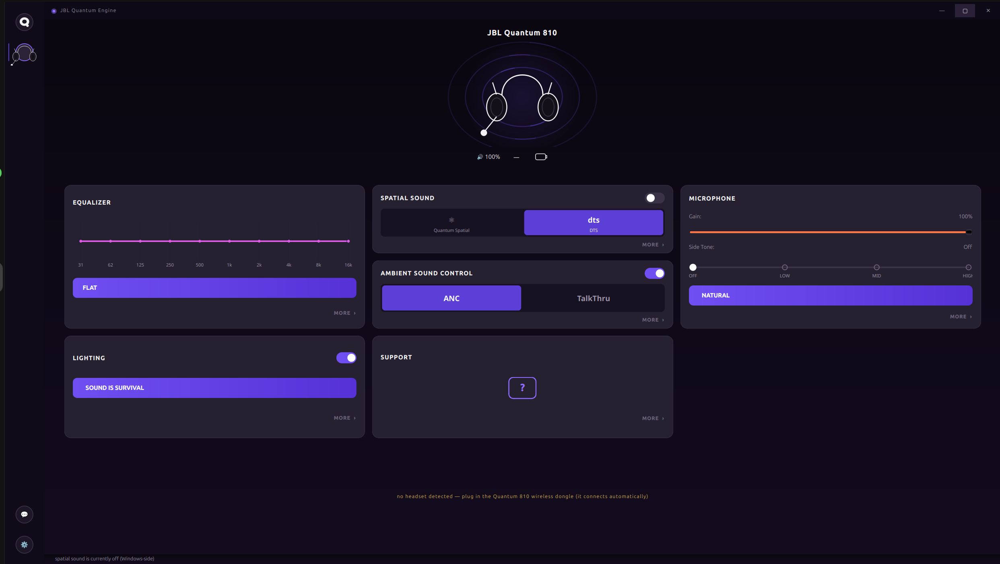

# JBL QuantumENGINE for Linux

An open-source, native **JBL QuantumENGINE alternative for Linux**, built by reverse
engineering the USB HID protocol used by JBL Quantum wireless headsets. The primary
and hardware-verified target is the **JBL Quantum 810 Wireless on Linux** (USB dongle
`0ecb:2069`). It runs directly through Python, hidapi, and hidraw—no Wine, virtual
machine, JBL binaries, or Windows installation required.

If you are searching for **JBL QuantumENGINE Linux**, **JBL Quantum 810 Linux
software**, or a way to control a **JBL Quantum headset on Linux**, this project is the
native community-built implementation.



## Working features

The following features are working on the hardware-verified JBL Quantum 810:

- Automatic headset detection, hotplug, and reconnect
- Battery level and charging-status monitoring
- Game/chat balance dial monitoring
- Microphone active and mute status
- Sidetone controls: off, low, mid, and high
- ANC on/off and TalkThru
- RGB lighting power, colours, zones, brightness, and effects
- Automatic power-off timer
- Product, serial-number, firmware, and device information
- Desktop GUI, `jblq` command-line interface, and hotplug-aware background daemon

The remaining major feature is the **DTS/QuantumSURROUND switcher**. JBL implements
EQ and spatial processing on the host rather than in the headset dongle, so native
Linux surround still needs a PipeWire filter-chain implementation. Contributions,
hardware testing, protocol findings, documentation, and bug reports are welcome.

## Headset support

The JBL Quantum 810 Wireless is verified on real hardware. The application also
recognizes sibling JBL Quantum models—including the Quantum 600, 610, 800, 850, 910,
910X, 910P, 950, 950X, and ONE—from JBL's device table, but those models still need
community hardware testing. Start with the read-only probe before enabling writes on
an unverified model.

This is personal interoperability work: it reimplements only the subset of the
QuantumENGINE device protocol supported by reproducible evidence. Firmware and DFU
commands are deliberately excluded.

## Project layout

- **`app/`** — the application: `jblq` CLI, hotplug-aware daemon, GUI, library, installer, udev rule
- **`docs/`** — protocol documentation, evidence, USB captures
  - [`PROTOCOL.md`](docs/PROTOCOL.md) — per-feature report table with
    evidence tags (our own capture parse vs upstream projects vs binary RTTI)
  - [`docs/PHASE0.md`](docs/PHASE0.md) — existing open-source work audit
    (don't re-RE what exists)
  - [`docs/captures/`](docs/captures/) — 23 action-labeled USBPcap captures
    (public, HeadsetControl issue #357) + our parser + analysis

## Downloads (v1.2.0)

- 🪟 **Windows:** [JBLQuantumEngine-windows-x64.exe](https://github.com/umarabdullah23/jbl-quantum-engine-linux/releases/latest/download/JBLQuantumEngine-windows-x64.exe) — one file, no install
- 🐧 **Linux:** [jbl-quantum-engine-linux-v1.2.0.zip](https://github.com/umarabdullah23/jbl-quantum-engine-linux/releases/latest/download/jbl-quantum-engine-linux-v1.2.0.zip) — full source + installer + protocol docs

All releases: <https://github.com/umarabdullah23/jbl-quantum-engine-linux/releases>

## Quick start

```bash
sudo cp app/udev/99-jbl-quantum.rules /etc/udev/rules.d/
sudo udevadm control --reload && sudo udevadm trigger
pip install hid            # hidapi bindings
./app/jblq probe    # read-only state dump — safe first step
```

## Credits / sources

- [sidmax7/QuantumEngine](https://github.com/sidmax7/QuantumEngine) (MIT/Apache) — the
  verified report map; `evidence-quantumengine-*.rs` are reference copies.
- [taron-sys/JBL-Quantum-810-Linux-Tray-Tool](https://github.com/taron-sys/JBL-Quantum-810-Linux-Tray-Tool)
  — auto-off report 0x75, RGB safety ranges, mute bracketing.
- [Sapd/HeadsetControl issue #357](https://github.com/Sapd/HeadsetControl/issues/357)
  by SWW13 — the USB captures.

## License

MIT for our code. Reference copies in `research/` keep their upstream licenses
(MIT/Apache-2.0). No JBL/Harman software or firmware is included; suspected DFU report
IDs are deliberately unreachable in the code.
